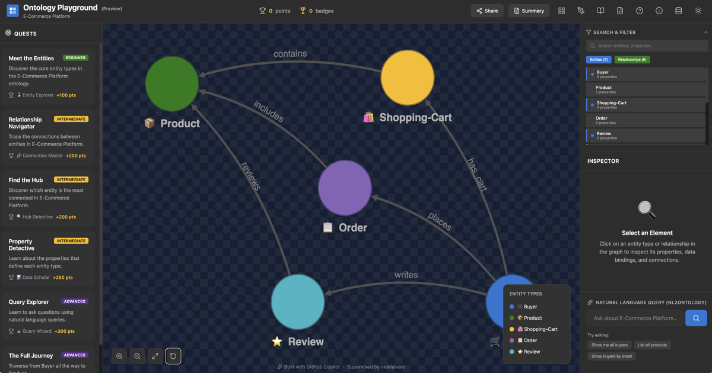

# Ontology Playground（预览）☕

[English](README.md) · [简体中文](README.zh-CN.md) · [日本語](README.ja.md)

> **翻译说明：** 此简体中文译文仅为提高可用性而按**“现状”（as is）**提供。术语和内容已由 **AI 依据 Microsoft Learn 官方简体中文文档进行核验**，但这并不代表 Microsoft 的官方翻译或认证。如有差异，以[英文 README](README.md)为准。

> 注意：本项目使用了 AI 辅助编程进行开发。

**[在线试用 &#x2192; microsoft.github.io/Ontology-Playground](https://microsoft.github.io/Ontology-Playground/)**

[](https://microsoft.github.io/Ontology-Playground/)

这是一个用于学习本体和 **Microsoft Fabric IQ** 的免费开源 Web 应用。
你可以探索预构建本体、在可视化编辑器中设计自己的本体、导出为
RDF/XML，并分享交互式图表——所有功能均来自完全静态的网站，
不依赖任何后端。


## 功能

### 交互式图探索

由 Cytoscape.js 驱动的图形系统，可将任意本体渲染为交互式的
节点与边图。你可以平移、缩放、点击节点查看属性，并使用
实时搜索栏筛选实体和关系。

### 本体目录

由官方与社区贡献本体组成的精选目录，涵盖六个领域
（零售、电子商务、医疗保健、金融、制造和教育）。
可按类别浏览、按名称或标签搜索、一键加载任意本体，
并查看或下载经过哈希验证的完整 RDF 源文件。目录卡片会保留并显示外部标准和经适配的
社区条目所提供的许可证、上游来源及版本归属信息。每个本体都有
可分享的深层链接（`/#/catalogue/official/cosmic-coffee`）。图是源文件的
可视化投影；在设计器中打开目录条目时，完整源文档会一并保留。

### 可视化本体设计器

全屏分栏编辑器，可用于从零创建本体或编辑现有本体。
添加带图标、颜色和类型化属性的实体类型；定义带基数的关系；
查看随操作实时更新的图预览。支持撤销/重做（50 级）、实时验证，
并可导出为 RDF/XML 或 JSON。对于带源文档的 RDF，设计器只允许修改
能精确映射到单一语句的现有标签、注释和直接 `rdfs:subClassOf` 边；
其余控件保持只读，撤销/重做会同时更新图投影与 RDF 补丁。

### RDF 导入与导出

RDF/XML 导入会同时保留原始字节、完整 RDF 图以及 Playground 的可视化投影。
未修改的文件会逐字节原样下载，包括 BOM、编码、格式和未映射语句。执行受支持的
编辑后，导出会序列化完整图及其补丁，而不是只重新生成可见子集；撤销全部净变更后，
文件会重新具备原始字节导出资格。

完整解析器会保留命名节点、空白节点、任意谓词、字面值词法形式、语言标签、
数据类型、OWL 限制、RDF 列表和 SHACL 语句。`owl:imports` 与 SHACL 始终保持
惰性，不会抓取外部资源或执行规则。当前限制为 8 MiB 和 250,000 条唯一语句；
不接受 `DOCTYPE`，也不会把命名图静默压平。Playground 中新建的本体仍可选择
Playground 往返配置或面向标准的 OWL + SHACL 配置。通过 URL 嵌入加载的
文件导入会在分配内容前检查声明的文件大小，并中止已被替换的读取。异步下载只会在
发起操作的文档和界面仍然有效时输出。大型完整源文件会作为单一纯文本节点显示，
避免创建无限增长的语法标记树；复制和下载仍使用完整源文件。
RDF/XML 也使用相同的大小、语句数和 `DOCTYPE` 限制。当前 Fabric API 只接受
可视化投影，因此带源文档的 RDF 无法直接推送到 Fabric；请改为下载完整 RDF。

图的呈现方式会
根据本体规模自动调整：小型本体保持完整显示；高密度本体保留全部数据，同时
减少标签干扰；超大型本体则先显示经过限制的语义层次结构概览。通过搜索、
调整层次深度以及展开标有 `+N` 的边界节点，无需一次绘制整个本体，也能访问
所有暂时隐藏的实体。目前不支持 Turtle 输入。

### 一键提交本体目录 PR

使用 GitHub（设备流程）登录，即可直接从设计器向社区本体目录
提交你的本体——应用会 fork 存储库、创建分支、提交 RDF 和元数据，
并自动发起拉取请求。该基于投影的流程仅用于 Playground 中新建的文档；
带源文档的 RDF 必须先导出并作为有意派生的文件进行审查。

### 可嵌入小组件

一个自包含的 JavaScript 文件（`ontology-embed.js`），只需一个
`<script>` 标签即可在任意网页上渲染交互式本体查看器。
支持深色/浅色主题、多种加载方式（目录 ID、URL、内联 Base64）
和点击查看详情。目录及 RDF/XML URL 来源还可显示和复制完整 RDF 源文件。
URL 来源按 8 MiB 上限读取，RDF/XML 会执行与文件导入相同的安全检查。
RDF 工作线程已包含在自包含嵌入包中，因此托管在其他 HTTPS 源上的小组件不会尝试
启动跨源工作线程脚本。详细信息请参阅[嵌入指南](docs/embed-guide.md)。

### 本体学校

结构化学习中心（`/#/learn`），包含 **9 门课程**，涵盖概念
学习路径与动手实验：

- **本体基础**——6 篇介绍核心概念的文章（什么是
  本体？→ RDF/OWL → Fabric IQ → 构建第一个本体 → 设计模式 →
  参与贡献）
- **7 条领域学习路径**——Fourth Coffee、电子商务、金融、医疗保健、
  制造、大学和 HR 系统。每条路径包含 4 篇渐进式文章，
  逐步构建本体，并通过实时嵌入图展示每个阶段新增的实体。
- **IQ 实验室：零售供应链**——一个分 7 步进行的动手实验，从零构建
  包含 15 个实体的本体（通过 6 个渐进式目录条目从 3 个扩展到 15 个实体）。

每篇文章都支持**演示模式**（在 `##` 标题处分割幻灯片），
并包含提供即时反馈的**交互式测验**。本体嵌入可从目录加载
实时图，并可选择突出显示差异。

### 任务系统

五个渐进式任务通过多步说明、提示、进度条和成就徽章，
引导用户学习本体概念。

### 自然语言查询试验场

输入自然语言问题（“哪些客户下过订单？”），查看这些问题如何
映射到本体实体与关系——这是 Fabric IQ 的 NL2Ontology
能力预览。

### 命令面板与键盘快捷键

在任意位置按 `⌘K` / `Ctrl+K` 可打开可搜索的命令面板。无需
离开键盘即可跳转到目录、设计器、本体学校、导入/导出、帮助等页面。
按 `?` 可快速访问帮助。使用方向键和 Enter 浏览命令面板。

### 入门模板

设计器提供五个领域模板（零售、医疗保健、金融、IoT、教育），
让新用户无需面对空白页面。每个模板会创建 3 个带属性的实体和
2 条关系，可直接进行自定义。

### 交互式引导之旅

首次访问者会看到包含聚光灯叠层的 5 步引导，依次突出显示
页眉、图、任务、检查器和设计器。可以关闭，并通过保存在
`localStorage` 中的“不再显示”选项记住此设置。

### 深层链接与 URL 路由

客户端哈希路由为每个页面提供可分享的 URL：

| 路由 | 页面 |
|-------|------|
| `/#/` | 首页（默认本体） |
| `/#/catalogue` | 本体目录 |
| `/#/catalogue/<source>/<slug>` | 指定本体（例如 `/#/catalogue/official/cosmic-coffee`） |
| `/#/designer` | 可视化设计器 |
| `/#/designer/<source>/<slug>` | 加载目录本体的设计器（例如 `/#/designer/official/cosmic-coffee`） |
| `/#/learn` | 本体学校——课程目录 |
| `/#/learn/<course>` | 课程详情——文章列表 |
| `/#/learn/<course>/<article>` | 文章视图（含演示模式） |

## 官方本体

| 领域 | 本体 | 实体 | 关系 |
|--------|----------|----------|---------------|
| 零售 | Fourth Coffee | 6 | 7 |
| 电子商务 | Online Retail | 5 | 6 |
| 医疗保健 | Clinical System | 5 | 6 |
| 金融 | Banking & Finance | 5 | 6 |
| 制造 | Industry 4.0 | 5 | 5 |
| 教育 | University System | 5 | 6 |

## 入门

### 先决条件

- Node.js 18+
- npm 9+

### 安装

```bash
cd Ontology-Playground
npm install
```

### 开发

```bash
npm run dev
```

访问 http://localhost:5173

### 生产构建

```bash
npm run build
```

构建管道会编译目录、编译学习内容 Markdown、执行类型检查、
打包应用并构建嵌入小组件。输出位于
`build/`。

### 运行测试

```bash
npm test            # single run
npm run test:watch  # watch mode
```

## 部署

### GitHub Pages（官方）

公开的 Ontology Playground 通过
`.github/workflows/deploy-ghpages.yml` 从 `main` 部署到 GitHub Pages。
该工作流只发布静态 `build/` 输出，不会部署可选的 `api/` 包。

Fork 所有者可以修改工作流中的存储库限制，然后在
**Settings → Pages → Source** 中选择 **GitHub Actions** 来使用 GitHub Pages。

### Azure Static Web Apps（可选）

Fork 所有者也可以选择使用 Azure Static Web Apps 托管静态前端：

1. 在 Azure 门户中创建静态 Web 应用
2. 将其连接到你的 fork
3. 将部署令牌添加为 GitHub 机密
   `AZURE_STATIC_WEB_APPS_API_TOKEN_GREEN_PLANT_0BB1D2910`
4. 推送到 `main`

附带的 Azure Static Web Apps 工作流也只发布静态资源，不会部署托管的
Azure Functions。Azure Functions API 是可选功能，需要它的用户可以自行部署。

### 环境变量

| 变量 | 默认值 | 说明 |
|----------|---------|-------------|
| `VITE_ENABLE_AI_BUILDER` | `false` | 启用 Azure OpenAI 本体构建器 |
| `VITE_ENABLE_LEGACY_FORMATS` | `false` | 启用 JSON/YAML/CSV 导入/导出格式 |
| `VITE_BASE_PATH` | `/` | 应用的基础路径（GitHub Pages 会自动设置） |
| `VITE_GITHUB_CLIENT_ID` | *（空）* | 用于一键提交本体目录 PR 的 GitHub OAuth App 客户端 ID（[设置指南](docs/github-oauth-setup.md)） |
| `VITE_GITHUB_OAUTH_BASE` | *（空）* | GitHub Pages 部署使用的外部 OAuth 代理 URL（例如 Cloudflare Worker URL） |
| `VITE_API_BASE` | `/api` | 单独部署的 API 路由基础 URL（例如 `https://example.azurewebsites.net/api`） |

## 项目结构

```
Ontology-Playground/
├── src/
│   ├── components/       # React components (graph, designer, modals, learn page)
│   ├── data/             # Ontology model, query engine, quest definitions
│   ├── lib/              # Router, RDF parser/serializer, catalogue helpers
│   ├── store/            # Zustand stores (app state, designer state)
│   ├── styles/           # CSS (Microsoft Fluent-inspired dark/light themes)
│   └── types/            # TypeScript type definitions
├── catalogue/            # Official + community ontology RDF files
├── content/learn/        # Course directories with markdown articles, quizzes, and metadata
├── scripts/              # Build-time compilers (catalogue, learning content)
├── api/                  # Azure Functions backend (optional, for AI builder)
├── docs/                 # Guides and documentation
├── public/               # Static assets (compiled catalogue.json, learn.json)
└── .github/workflows/    # CI/CD (Azure SWA + GitHub Pages)
```

## 文档

下表列出了主要的最终用户与贡献者指南。内部规划说明
（例如 `docs/TODO-*.md`）有意不纳入已发布的文档集。

| 指南 | 说明 |
|-------|-------------|
| [本体编写指南](docs/authoring-guide.md) | 如何创建适用于 Playground 的本体——逐字段参考、最佳实践和分步演练 |
| [贡献本体：从设计到 GitHub](docs/contributing-ontology-from-design-to-github.md) | 端到端贡献流程：设计、RDF 导出、元数据、本地验证和拉取请求 |
| [嵌入指南](docs/embed-guide.md) | 如何在任意网页中嵌入交互式本体小组件 |
| [GitHub OAuth 设置](docs/github-oauth-setup.md) | 如何为一键提交本体目录 PR 配置 GitHub OAuth |
| [嵌入安全](docs/embed-security.md) | 可嵌入小组件的安全模型 |
| [学习内容指南](docs/learn-content-guide.md) | 如何为本体学校编写课程、文章、测验和本体嵌入 |
| [本体学校审核工作流](docs/ontology-school-review-workflow.md) | 学校课程内容的人工审核与批准流程 |
| [主题编写指南](docs/theme-authoring-guide.md) | 如何将新配色主题接入 Playground——令牌契约、appStore 和 CSS 步骤及对比度注意事项 |

## AI 代理快速入门

本存储库包含 Copilot 自定义文件，使代理能够可靠地：

- 将客户 RDF/OWL 导入为可直接加入本体目录的格式
- 生成渐进式本体学校模块
- 让课程内容通过人工审核工作流

包含的资源：

- 技能：
   - `.github/skills/ontology-catalog-import/`——将外部/客户 RDF/OWL 导入本体目录格式
   - `.github/skills/ontology-school-path-generator/`——生成渐进式本体学校模块
   - `.github/skills/community-ontology-contribution/`——按照正确的目录结构、元数据和验证要求，在 `catalogue/community/` 下添加贡献者本体
   - `.github/skills/name-generator/`——从已批准的 CSV 固件中为示例、演示、任务、测试和样例数据生成人名
- RDF 接收说明：
   - `.github/instructions/rdf-intake.instructions.md`
- 可复用提示：
   - `.github/prompts/import-rdf-to-catalog.prompt.md`
   - `.github/prompts/generate-ontology-school-module.prompt.md`

合并前建议执行以下验证：

```bash
npm run qa:tutorial-content
npm run build
```

## 技术栈

- **React 19** + TypeScript 5
- **Cytoscape.js**——图可视化（fcose 布局）
- **Zustand**——状态管理
- **Vite**——构建工具
- **Framer Motion**——动画
- **Lucide Icons**——图标库
- **marked**——Markdown 编译（构建时）

## 了解更多

- [Microsoft Fabric IQ 本体（预览版）文档](https://learn.microsoft.com/zh-cn/fabric/iq/ontology/overview)
- [Azure Static Web Apps](https://learn.microsoft.com/zh-cn/azure/static-web-apps/)

## 许可证

MIT

## 商标声明

商标：本项目可能包含项目、产品或服务的商标或徽标。
对 Microsoft 商标或徽标的授权使用必须遵守 Microsoft 的商标与品牌指南。
在本项目的修改版本中使用 Microsoft 商标或徽标时，不得造成混淆或
暗示 Microsoft 赞助。任何第三方商标或徽标的使用均受相应第三方政策约束。
